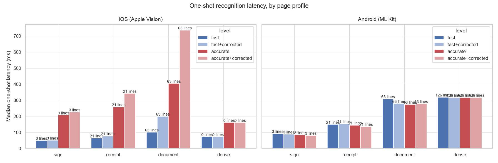
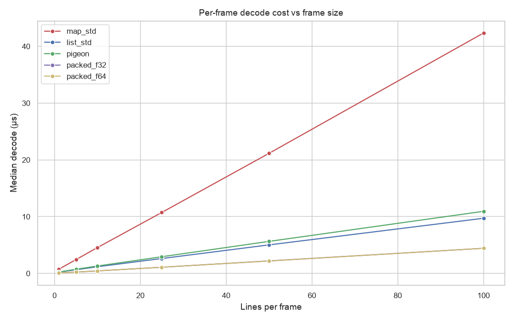
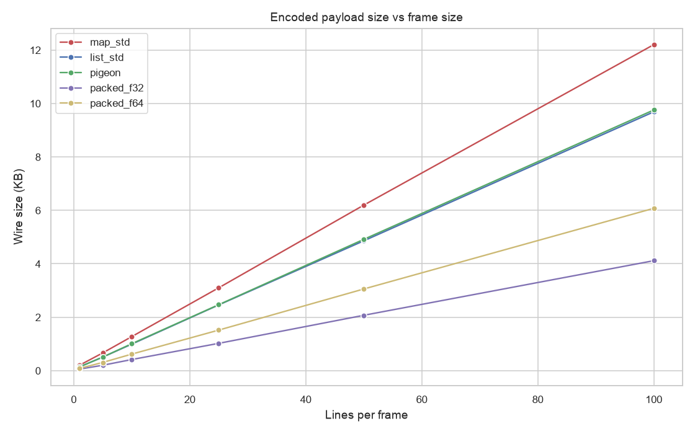
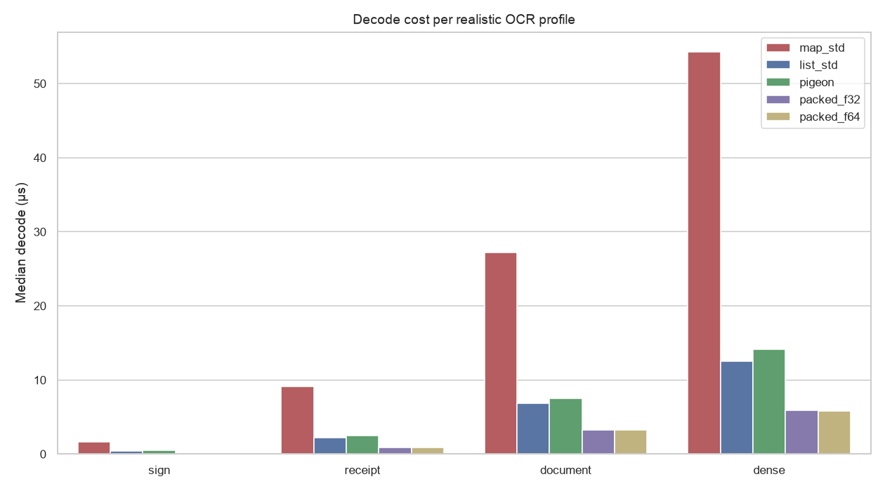

# Performance

Captured on a physical Galaxy S24 and iPhone 16 in profile mode. Your hardware will differ. Full
method and numbers live in [`benchmark/`](../benchmark/README.md).

## One image

What `TextSight.recognizeImage` costs, by page density. Read the line count beside each bar: a level
that recognizes nothing returns fast, which would otherwise look like a win.

On Android all four bars coincide. ML Kit's Latin recognizer has no accuracy dial and corrects on
its own, so neither knob does anything.

On iOS both knobs bite, and they stack:

| iOS, the 63-line page   |    p50 |
|-------------------------|-------:|
| `fast`                  | 101 ms |
| `fast` + correction     | 199 ms |
| `accurate`              | 404 ms |
| `accurate` + correction | 736 ms |

Roughly 4x for the level, then double again for correction. Both levels read every line on pages
this clean, so reach for `fast`.

Neither iOS level reads the 127-line page. It renders at 15.8 pt and Vision returns nothing that
small here, so those bars time a miss. Android reads 126 of 127.

## Live camera

[`LIVE_SUMMARY.md`](../benchmark/reports/LIVE_SUMMARY.md) has the recognized frames per second for each
level, on the whole frame and through the README's strip, both phones on the same page at once.

- **A scan box pays off.** Through the strip, iOS `fast` keeps up with the camera itself, and
  Android gets through up to twice the frames.
- **iOS `accurate` is the exception.** It barely speeds up.
- **Fewer lines through the strip is the point.** It only reads what's in the box.

Android asks CameraX for about 2 MP in 4:3, iOS for 1080p. `CaptureResolution.low` trades lines
for frame rate.

**Don't read this as iOS versus Android.** Different capture sizes and shapes mean different work
per frame, and both depend on what the camera sees.

> Phones boost when cool, so the report's settled numbers are the floor. A short scan feels quicker.

## The transport is not the bottleneck

Results cross from native to Dart as a small per-frame map. Decoding one on the UI isolate costs
**microseconds**: worst case on the slower phone, a dense 127-line frame is 87 µs, 0.5% of a 60 fps
frame. The recognizer sets the pace.

Host-measured charts, for the finer sweep a phone run doesn't produce

Leaner wire formats win big in *percent* and stay tiny in absolute microseconds, which is why the
self-describing map stays.

